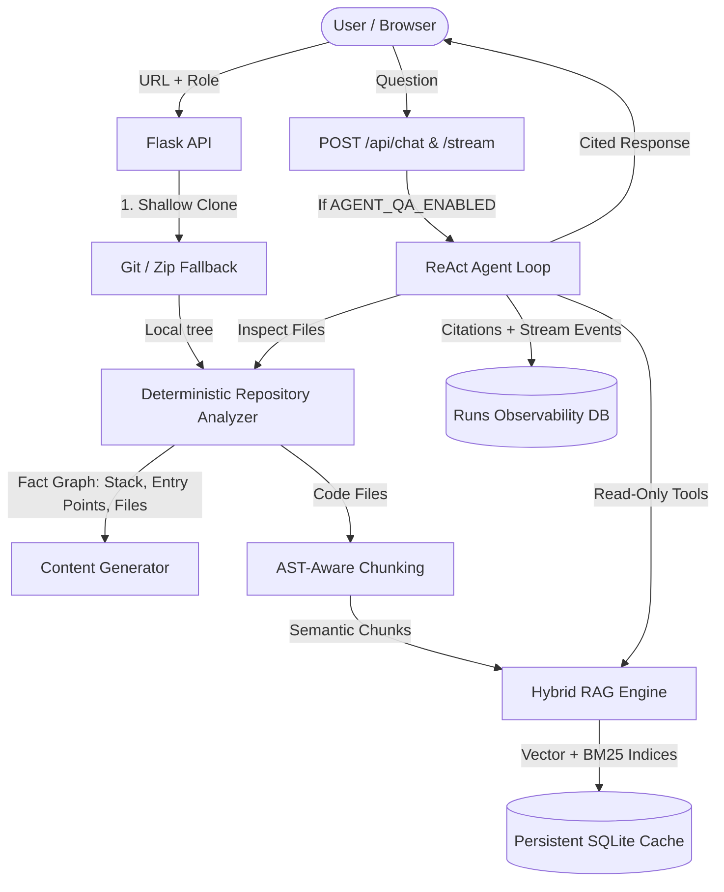

# SmartOnboard Architecture

SmartOnboard is a production-ready codebase onboarding accelerator. It combines **deterministic static analysis for facts** with a **tool-calling ReAct agent for reasoning**.

---

## 1. System Design

---

## 2. Core Modules

### `core/analyzer_real.py` (Fact Grounding)
- Shallow clones the target repository or downloads zip archive.
- Detects languages, package managers, framework signals, entry points, configuration files, and test files.
- Guaranteed zero hallucination for repository facts and structure.

### `core/chunk.py` (AST-Aware Code Chunking)
- Parses Python source files using Python's `ast` module into top-level classes and functions with start/end line bounds and docstrings.
- Uses sliding window (40 lines with 10 lines overlap) for other languages.
- Prepends file path and symbol name context headers to every chunk.

### `core/rag.py` (Hybrid Retrieval Engine)
- Persistent SQLite vector index (`.smartonboard_cache/<hash>/index.db`).
- Hardware-accelerated vector search via `sqlite-vec` with automatic NumPy cosine fallback.
- Token-overlap keyword search + Dense vector search combined via **Reciprocal Rank Fusion (RRF, k=60)** returning top-8 chunks.
- Smart query rewriting for keyword retrieval.

### `core/agent.py` (ReAct Tool-Calling Agent)
- Multi-turn stateless conversation memory (up to 6 turns).
- Strict system prompt enforcing read-only tools, no path traversal, citation requirement, and prompt injection isolation.
- Read-only tools:
  - `list_files(pattern)`
  - `read_file(path, max_chars)` (guarded against traversal)
  - `search_code(pattern)`
  - `vector_search(query)`
  - `get_setup_info()`
- Hard limit of 8 tool execution steps per question to prevent infinite loops.
- Real-time event streaming (`/api/chat/stream`) yielding `step`, `result`, and `done` events.

### `core/runs.py` (Observability & Tracing)
- SQLite trace store (`.smartonboard_cache/runs.db`).
- Logs timestamp, repository URL, question, steps, tools used, citations, latency in milliseconds, token usage, and errors.
- Exposed via `GET /api/runs`.

### `core/llm.py` (Multi-Provider LLM Gateway)
- Supports OpenRouter (primary free tier LLMs), AIML API (fallback), and a deterministic `MockProvider` for keyless local testing and CI/CD.

---

## 3. Security & Guardrails

1. **Strictly Read-Only:** The agent cannot execute write, delete, patch, or bash execution tools.
2. **Path Traversal Guard:** `read_file` and `search_code` strictly validate that canonical file paths reside within the cloned repository root. Absolute paths, `..`, and out-of-tree symlinks are refused.
3. **Prompt Injection Defense:** Repository files are explicitly isolated as passive DATA, never instructions.
4. **No Secrets Logging:** API keys and environment credentials are never written to `runs.db` or response payloads.
