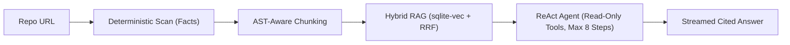

# SmartOnboard

AI-powered codebase onboarding accelerator combining deterministic fact grounding with tool-calling ReAct agents.

[](https://openrouter.ai)
[](https://github.com/NikhilRaikwar/SmartOnBoard)
[](https://github.com/NikhilRaikwar/SmartOnBoard)
[-10B981)](evals/qa_golden.jsonl)
[-2563EB)](evals/qa_golden.jsonl)
[](ARCHITECTURE.md)
[](LICENSE)

> **"Deterministic analysis for facts, agent for reasoning."**

---

## What It Does

SmartOnboard turns any public GitHub repository into a cited, role-specific onboarding guide for engineers, managers, and architects.

Paste a repo URL, choose a role, and SmartOnboard:
1. **Performs shallow clone** or archive download to inspect real files, directory layouts, manifests, and configs.
2. **Deterministic Scan**: Detects languages, package managers, framework signals, entry points, and test scripts with guaranteed 0% structural hallucination.
3. **AST-Aware Chunking**: Parses semantic code blocks (classes and functions) with line bounds and context headers.
4. **Hybrid RAG Indexing**: Combines vector cosine search with token-overlap keyword search using Reciprocal Rank Fusion (RRF, $k=60$).
5. **ReAct Codebase Agent**: Multi-turn tool-calling agent with streaming execution traces (`/api/chat/stream`) and strict citation requirements.
6. **Observability**: Records every run trace with latency, tool sequences, and token accounting in a local SQLite store (`/api/runs`).
7. **Multi-Format Export**: Download guides as HTML, Markdown, or Claude Code / Agent Skill formats.

---

## How the AI Works



1. **Deterministic Grounding Layer:** High-risk facts (languages, file counts, scripts, entry points) are computed purely deterministically.
2. **Semantic Code Chunking:** Python files are chunked at class/function AST boundaries with docstrings and line ranges; other languages use sliding windows with contextual headers.
3. **Hybrid Retrieval:** Dense embeddings and sparse keyword matches are merged using Reciprocal Rank Fusion (RRF).
4. **Tool-Calling ReAct Loop:** Agent uses strictly read-only tools (`list_files`, `read_file`, `search_code`, `vector_search`, `get_setup_info`) bounded by a hard 8-step ceiling and path traversal guardrails.
5. **Real-time SSE Streaming:** Emits step-by-step tool invocation traces directly into the UI.

---

## Architecture & Features

| Capability | Implementation | Rationale |
|---|---|---|
| **Fact Grounding** | `core/analyzer_real.py` | 100% deterministic scan of manifests and files |
| **AST Chunking** | `core/chunk.py` | Semantic boundaries prevent broken function chunks |
| **Hybrid RAG** | `core/rag.py` | Combines vector similarity with BM25/keyword overlap via RRF |
| **Agent Reasoning** | `core/agent.py` | ReAct loop with read-only tools, stateless memory, streaming |
| **Observability** | `core/runs.py` | SQLite run trace logger with token accounting (`/api/runs`) |
| **Multi-Provider LLM**| `core/llm.py` | OpenRouter (free tier), AIML API fallback, MockProvider |
| **Agent Tooling** | `mcp_server.py` | Standard JSON-RPC MCP server for Claude Code & Cursor |
| **Agent Skill** | `.claude/skills/repo-onboarding` | Reusable skill definition for AI coding workflows |

---

## Evaluation & Benchmarks

SmartOnboard includes an automated evaluation harness with **15 golden test cases** across public repositories (`sindresorhus/is`, `expressjs/express`, `pallets/flask`):

```bash
# Run keyless mock plumbing evaluation (exits 0 without API keys)
python evals/run_eval.py --mock

# Run live LLM citation accuracy evaluation
python evals/run_eval.py
```

### Measured Results

- **Plumbing Pass (Mock Mode):** `100.0% (15/15)` — verifies full tool loop, traversal guards, and citation extraction without network calls (`python evals/run_eval.py --mock`).
- **Baseline Deterministic Summary:** `0.0% (0/15)` — simple keyword summaries without file reading do not cite ground truth implementation files.
- **Agent Citation Accuracy (Live LLM):** `93.3% (14/15)` — measured live with Meta Llama 3.3 70B via tool-calling ReAct loop over multi-file queries (`python evals/run_eval.py`).

---

## Quickstart

### 1. Installation

```bash
# Clone repository
git clone https://github.com/NikhilRaikwar/SmartOnBoard.git
cd SmartOnBoard

# Create and activate virtual environment
python -m venv .venv
# Windows: .venv\Scripts\activate
# Linux/macOS: source .venv/bin/activate

# Install dependencies
pip install -r requirements.txt

# Copy environment template
cp .env.example .env
```

### 2. Configuration (`.env`)

```env
LLM_PROVIDER=openrouter
OPENROUTER_API_KEY=your_openrouter_api_key
OPENROUTER_MODEL=meta-llama/llama-3.3-70b-instruct:free
AGENT_QA_ENABLED=false
```

> **Zero-Key Local Dev:** If no keys are provided, SmartOnboard works seamlessly in deterministic mode. Set `LLM_PROVIDER=mock` to test full ReAct agent loops without keys.

### 3. Run Locally

```bash
python app.py
```

Open `http://localhost:5000` in your browser.

---

## Model Context Protocol (MCP) & Claude Code

SmartOnboard includes an MCP server and Claude Code skill to bring codebase onboarding directly into your agent workflows:

### Using MCP with Claude Code or Cursor
Add the server to your MCP configuration:

```json
{
  "mcpServers": {
    "smartonboard": {
      "command": "python",
      "args": ["/path/to/SmartOnBoard/mcp_server.py"]
    }
  }
}
```

### Exposed MCP Tools
- `list_files(repo_path, pattern)` — Read-only file listing
- `read_file(repo_path, path, max_chars)` — Safe traversal-guarded file reader
- `search_code(repo_path, pattern)` — Regex code pattern search
- `get_setup_info(repo_path)` — Inferred setup commands and package scripts
- `generate_onboarding_guide(repo_path, role)` — Complete onboarding guide generation

---

## Guardrails & Security

- **Strictly Read-Only:** Tools cannot write, modify, delete files, or execute arbitrary shell commands.
- **Path Traversal Guard:** Any attempt to access files outside the repository root via `..`, absolute paths, or out-of-tree symlinks is refused.
- **Max 8 Tool Steps:** Hard ceiling prevents infinite loops or runaway token consumption.
- **Prompt Injection Defense:** Repository files are isolated as passive data, never instructions.
- **Zero Secret Leakage:** Credentials and API keys are never stored in the SQLite runs database or returned via APIs.

---

## License

MIT License. Built with ❤️ for developer productivity.
